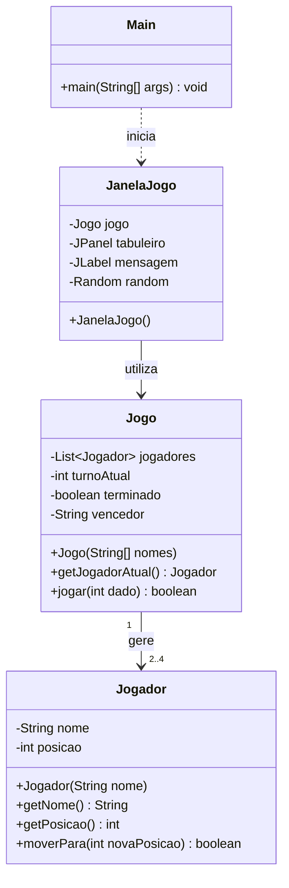

# Ilha do Tesouro — Diagrama UML Inicial

**Unidade curricular:** Programação Orientada a Objectos  
**Universidade:** Universidade Autónoma de Lisboa  
**Ano letivo:** 2026/2027

## 1. Diagrama de classes

## 2. Explicação das classes

- **Jogador:** guarda o nome e a posição de um jogador.
- **Jogo:** controla os jogadores, os turnos, os movimentos e a vitória.
- **JanelaJogo:** apresenta o tabuleiro e permite jogar através da interface gráfica.
- **Main:** inicia a aplicação.

## 3. Relações entre classes

**Jogo e Jogador:** relação de associação (has-a).
Um jogo gere entre dois e quatro jogadores.

**JanelaJogo e Jogo:** relação de associação (has-a).
A janela utiliza um objeto Jogo.

**Main e JanelaJogo:** dependência.
A classe Main inicia a janela do jogo.

## 4. Evolução prevista

Nas próximas etapas, o modelo poderá ser
expandido para representar explicitamente
o tabuleiro e as casas especiais.

Essas classes ainda não fazem parte
do protótipo inicial.
